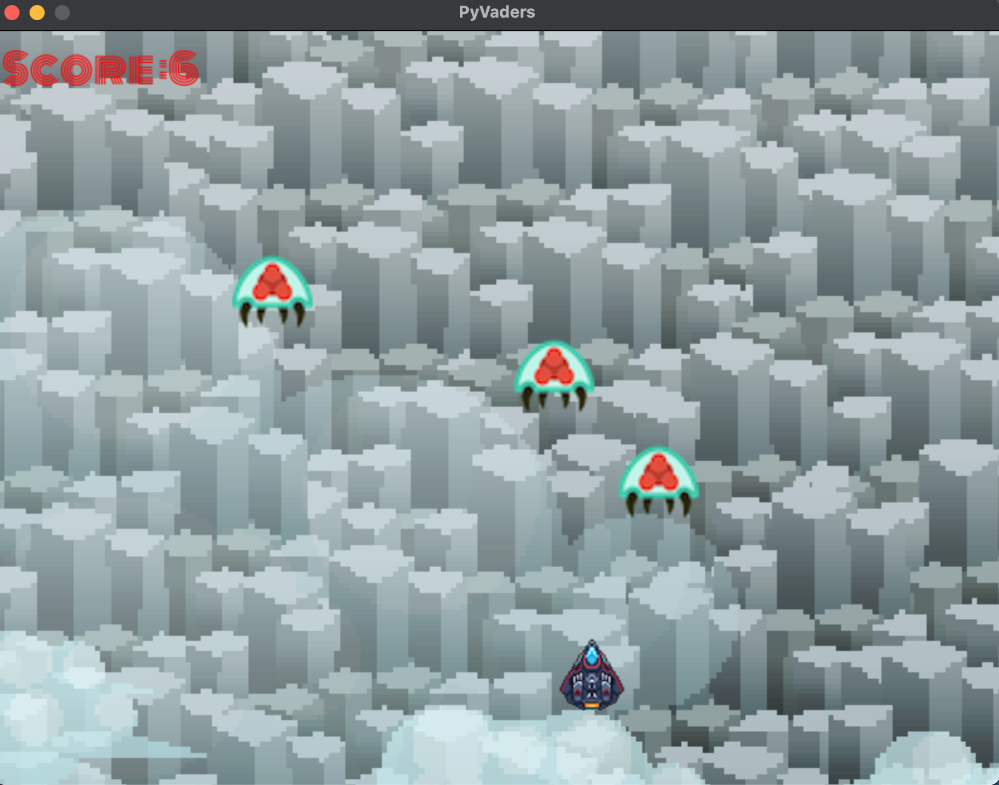

# cvaders 👾 🚀



A Space Invaders clone written in **C11** with **SDL2**. This repository is a
memory-safe, unit-tested C port of the original Python/pygame
[PyVaders](https://github.com/nixbytes/pyvaders) game.

[Source wiki](https://en.wikipedia.org/wiki/Space_Invaders)

> Within the shooter genre, Space Invaders was the first fixed shooter and set the template for the shoot 'em up genre. The goal is to defeat wave after wave of descending aliens with a horizontally moving laser to earn as many points as possible.

If an alien touches the ship it's **Game Over**. Destroyed aliens respawn at a
new random position and add to your score.

## Controls 🎮

| Action | Key |
|--------|-----|
| Move left / right | Left / Right arrow keys |
| Fire laser | Space bar |
| Quit | Close the window |

## Requirements

- A C11 compiler (`cc`, `gcc`, or `clang`) and `make`
- SDL2, SDL2_image, SDL2_ttf, and SDL2_mixer

On macOS with Homebrew:

```sh
brew install sdl2 sdl2_image sdl2_ttf sdl2_mixer
```

On Debian/Ubuntu:

```sh
sudo apt install build-essential libsdl2-dev libsdl2-image-dev \
    libsdl2-ttf-dev libsdl2-mixer-dev
```

## Build and run

Build the game with the Makefile in `c/`:

```sh
make -C c all
./c/build/pyvaders
```

The game loads its assets from `assets/` using paths relative to the current
working directory, so run the binary from the repository root as shown above.

The pure game logic has no SDL dependency and can be built and tested with only
a C compiler:

```sh
make -C c test
```

Other useful targets:

```sh
make -C c test-asan   # tests under AddressSanitizer + UBSan
make -C c valgrind    # tests under valgrind (leak check)
make -C c clean       # remove build artifacts
```

## Project structure

```text
c/
├── include/
│   └── pyvaders.h      # public game types, constants, and function prototypes
├── src/
│   ├── game.c          # pure game logic (no SDL; unit tested)
│   ├── render.h        # SDL frontend interface
│   ├── render.c        # window, textures, audio, font, and frame drawing
│   └── main.c          # entry point and game loop
├── test/
│   └── test_game.c     # Unity-based tests for game.c
├── third_party/
│   └── unity/          # tiny test framework
└── Makefile            # build, test, sanitizer, and valgrind targets
```

The design deliberately separates the rules from the rendering:

- `game.c` owns all mutable state in a single `GameState` struct, uses one heap
  allocation (`game_init` / `game_free`), and stores enemies in a fixed-size
  array of `Alien` structs.
- A seedable xorshift32 PRNG makes runs reproducible for tests.
- `render.c` loads each texture, sound, and font once at startup and releases
  everything in `renderer_destroy`, so there are no per-frame allocations.

For a beginner-friendly walkthrough of the C port, see
[C_BUILDING_TUTORIAL.md](./C_BUILDING_TUTORIAL.md).

## Testing

The test binary covers collision math, player clamping, alien wall bouncing,
game-over detection, respawning/scoring, laser recycling, spawn ranges,
determinism, and NULL-pointer safety.

```sh
make -C c test
# +20 - 20 Tests 0 Failures 0 Ignored
```

A clean run of `make test`, `make test-asan`, and `make valgrind` is the
project's memory-safety check.

## How to contribute

Goal: to get more people contributing to simple projects without worrying about
it being serious. Learn how to contribute to (but not limited to) this repo,
Git tooling, documentation, and artwork for software.

Some guidelines ✅:

- All code must be open source for this specific commit and project.
- Any asset added must have its source credited in [CREDIT.md](./CREDIT.md).
  Artists are welcome to contribute.
- Be nice and respectful of new ideas or approaches. All skill levels are
  welcome.
- You can contribute in any form, including docs, art, music, marketing, and
  research.
- If you want to build from scratch, check [CREDIT.md](./CREDIT.md) for sources
  and the original course.
- Final commits go to `main`; ideas and concepts should live on a
  [branch](https://git-scm.com/book/en/v2/Git-Branching-Basic-Branching-and-Merging).

## Todo

- [ ] Add more levels
- [ ] Improve performance
- [ ] Create a single binary for distribution
- [ ] Update the wiki
- [ ] Add CI for the build and tests

## Credits

Source code, artwork, music, and fonts are credited in
[CREDIT.md](./CREDIT.md).

## License

This project is released under the MIT License. See [LICENSE](./LICENSE) for
the full text.

Copyright (c) 2020 Nixbytes
